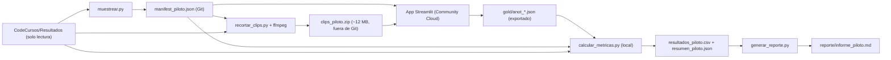

# Plan Arquitectónico — Etapa 1 (Piloto): ASR y Diarización Textual

- **Etapa:** `ETAPA_1_speech2textDi` (Piloto)
- **Especificación base:** [spec.md](spec.md)
- **Entorno de despliegue de la app:** Streamlit Community Cloud (Python 3.11)
- **Entorno de muestreo, recorte y métricas:** Ejecución local en Linux con acceso de **solo lectura** a `/home/jd/Escritorio/CodeCursos`

---

## 1. Arquitectura general del flujo

El diseño separa estrictamente dos entornos para respetar la regla de **no versionar audios en Git** y evitar exponer el corpus completo de `/home/jd/Escritorio/CodeCursos` en la nube:

1. **Entorno local (investigador):** accede en solo lectura a `/home/jd/Escritorio/CodeCursos/Resultados/`, ejecuta el muestreo determinista, recorta los 24 MP3 en `clips_piloto.zip`, y posteriormente calcula métricas y genera el informe a partir del JSON exportado.
2. **Entorno web (Streamlit Community Cloud):** solo lee `muestreo/manifest_piloto.json` desde GitHub (que incluye la `precarga_ui` de los 24 clips, ~30 KB) y recibe los 24 MP3 (~12 MB) desde `st.secrets["CLIPS_ZIP_URL"]` o por subida manual de `clips_piloto.zip` en disco efímero `/tmp/`.



---

## 2. Estructura de archivos de la etapa

```text
ETAPA_1_speech2textDi/
├── GUIA_SDD.md                     # Resumen de Fase 1 y decisiones cerradas
├── sdd/                            # Artefactos vivos de SDD (Fases 2 y 3)
│   ├── spec.md
│   ├── plan.md
│   ├── research.md
│   ├── data-model.md
│   ├── tasks.md                    # (Fase 3)
│   └── contracts/
│       ├── cli_muestrear.md
│       ├── cli_metricas.md
│       └── cli_reporte.md
├── core/                           # Lógica pura compartida (sin I/O de UI)
│   ├── __init__.py
│   ├── io_diario.py                # Lectura de Diario/*.json, interpolación y herencia de speaker
│   ├── normalizacion.py            # Normalización determinista de texto español
│   ├── validacion_esquemas.py      # Validadores de manifest y archivo de anotación
│   └── hashes.py                   # Cálculo y verificación SHA-256 determinista
├── muestreo/
│   ├── muestrear.py                # Genera manifest_piloto.json (Estratos A y B)
│   ├── recortar_clips.py           # Recorta MP3 con ffmpeg, actualiza sha256_clip y crea ZIP
│   ├── manifest_piloto.json        # Versionado en Git (sin audios)
│   └── clips/                      # Ignorado en .gitignore (MP3s y clips_piloto.zip)
├── app/
│   ├── streamlit_app.py            # Punto de entrada para Streamlit Community Cloud
│   ├── cargador_clips.py           # Descarga desde st.secrets o file_uploader + verificación SHA-256
│   ├── estado_anotacion.py         # Manejo de session_state, cronómetro, dividir/unir y JSON I/O
│   └── requirements.txt            # Dependencias mínimas de la app en Streamlit Cloud
├── gold/                           # Archivos anot_*.json exportados por el anotador
├── metricas/
│   ├── calcular_metricas.py        # CLI: WER, CER, WDER, cpWER, entidades, seg vs word, bootstrap
│   ├── calculo_asr.py              # WER, CER, extracción automática de cifras/siglas/entidades
│   ├── calculo_diarizacion.py      # WDER, cpWER, ΔH, fragmentación < 10 palabras
│   ├── inferencia.py               # Bootstrap no paramétrico y cálculo de n final (s_UCL)
│   ├── resultados_piloto.csv       # Generado tras cerrar piloto
│   └── resumen_piloto.json         # Generado tras cerrar piloto
├── reporte/
│   ├── generar_reporte.py          # CLI: genera reporte/informe_piloto.md
│   └── informe_piloto.md           # Informe final del piloto
├── tests/                          # Fase 5: pruebas unitarias con casos sintéticos
│   ├── test_normalizacion.py
│   ├── test_io_diario.py
│   ├── test_metricas_sinteticas.py
│   └── test_muestreo_y_esquemas.py
├── requirements-dev.txt            # Dependencias locales completas (muestreo, métricas, pytest)
└── quickstart.md                   # (Fase 5) Manual de uso paso a paso
```

---

## 3. Decisiones arquitectónicas clave

### 3.1 Precarga embebida en `manifest_piloto.json`
- Al generar `manifest_piloto.json`, `muestrear.py` extrae las palabras del intervalo `[inicio_s, fin_s]` (aplicando la interpolación lineal de `io_diario.py`), las agrupa en turnos según `segment["speaker"]` y remapea las etiquetas en orden de aparición a `H1`, `H2`, ...
- Guardar estos turnos como `precarga_ui` dentro de `manifest_piloto.json` (~30 KB totales para 24 clips) permite que la app en **Streamlit Community Cloud** sea 100 % autosuficiente sin acceso a `/home/jd/Escritorio/CodeCursos`.
- Los campos sensibles al sesgo (`estrato`, `cambio_turno_ancla_s`, `entrevista` original, `candidato_slug`) permanecen en el manifest para trazabilidad, pero **la UI nunca los renderiza**.

### 3.2 Carga segura de clips en Streamlit Community Cloud
Para respetar `.gitignore` (no versionar audio) y lidiar con el disco efímero de Streamlit Community Cloud:
1. **Ruta preferente (automática):** si existe `st.secrets["CLIPS_ZIP_URL"]` (por ejemplo, un dataset privado en Hugging Face con `st.secrets["CLIPS_ZIP_TOKEN"]` o un enlace privado firmado), la app descarga `clips_piloto.zip` una sola vez mediante `@st.cache_resource` en `/tmp/validacandi_clips/<sha256_manifest>/`.
2. **Ruta de respaldo (manual, cero infraestructura extra):** si no hay secretos configurados, la barra lateral muestra un `st.file_uploader("Cargar clips_piloto.zip", type=["zip"])`. Al subir los ~12 MB, la app descomprime en `/tmp/` y verifica cada `sha256_clip` contra `manifest_piloto.json`.
3. Si algún archivo falta o su hash difiere, la app bloquea el inicio y muestra el detalle exacto.

### 3.3 Interfaz de tarjetas por turno sin reinicio de audio
Un problema clásico en Streamlit es que cada interacción de botón o `text_area` re-ejecuta el script y reinicia `st.audio`. Mitigación arquitectónica:
- Aislar el reproductor de audio en un contenedor estable y utilizar **`@st.fragment`** (nativo en Streamlit >= 1.37) para la lista de tarjetas de turnos, de modo que editar texto, dividir o unir tarjetas **solo re-renderice el fragmento de tarjetas y nunca reinicie el reproductor de audio**.
- Reproductor HTML5 ligero con botones de control rápidos (`-5 s`, `+5 s` y selector de velocidad `0.75x / 1.0x / 1.25x`) embebido con el audio del clip actual en base64/blob (~0,5 MB por clip) para control fluido con teclado/mouse.
- **Mecánica de `Dividir turno` (simple y sin JS complejo):**
  - El anotador escribe `||` en el punto exacto donde empieza el otro hablante dentro de la caja de texto de la tarjeta y pulsa el botón **`Dividir en ||`** (o pulsa `Dividir` para abrir un selector de palabra de corte si no escribió `||`).
  - La app divide la tarjeta en dos, conserva la etiqueta actual en la primera mitad y propone automáticamente el siguiente hablante distinto en la segunda mitad (editable mediante desplegable `H1`, `H2`, ...).
- **Mecánica de `Unir con anterior`:** concatena el texto de la tarjeta $k$ al final de la tarjeta $k - 1$ con un espacio y elimina la tarjeta $k$.
- **Validación visual en vivo:** indicador de progreso (`X / 24 clips`), estado del clip (`pendiente` / `en_progreso` / `completo` / `no_anotable`), resumen de hablantes en el clip y botón **Deshacer último cambio** en la pila local del clip.

### 3.4 Persistencia, respaldo en navegador y cronómetro
- **Archivo JSON de progreso:** botón fijo en la barra lateral para **Exportar JSON** (`anot_{anotador}_{fecha}_n{completados:03d}.json`) e **Importar JSON** (validado por `sha256_manifest` y esquema).
- **Recordatorio automático:** banner suave cada 3 clips completados desde la última exportación.
- **Respaldo en `localStorage`:** sincronización automática vía pequeño snippet HTML/JS ligero (`streamlit-js-eval` o componente mínimo de 15 líneas sin dependencias pesadas) keyed por `sha256_manifest`, de modo que si Streamlit Cloud se suspende o se recarga la pestaña, el trabajo no exportado se ofrece para restaurar al volver.
- **Cronómetro por clip:** al abrir un clip se guarda `t_inicio_vista = time.monotonic()`; al guardar/cambiar de clip o marcar completo se suma `delta` (acotado a un máximo de 15 min por pausa inactiva para no inflar el tiempo si el anotador dejó la pestaña abierta) a `tiempo_anotacion_s`.

### 3.5 Separación estricta entre anotación y evaluación
- `app/streamlit_app.py` **no** importa `jiwer`, `scipy` ni librerías pesadas de métricas; solo depende de `streamlit` y la biblioteca estándar de Python (`json`, `hashlib`, `zipfile`, `pathlib`, `re`). Esto garantiza arranque rápido (<10 s) y consumo mínimo de RAM (<250 MB) dentro de los límites de Streamlit Community Cloud.
- Todo cálculo estadístico y lectura de `/home/jd/Escritorio/CodeCursos` ocurre exclusivamente en local mediante `metricas/calcular_metricas.py` y `reporte/generar_reporte.py`.

---

## 4. Entornos y dependencias

### `ETAPA_1_speech2textDi/app/requirements.txt` (Streamlit Community Cloud, Python 3.11)
- `streamlit>=1.39,<2.0`

### `ETAPA_1_speech2textDi/requirements-dev.txt` (Entorno local `validacandi`, Python 3.11)
- `streamlit>=1.39,<2.0`
- `jiwer>=3.0,<4.0`
- `numpy>=1.26,<3.0`
- `pandas>=2.2,<3.0`
- `scipy>=1.13,<2.0`
- `pytest>=8.0,<9.0`
- Herramienta del sistema: `ffmpeg` (ya verificado en `/home/jd/miniconda3/bin/ffmpeg`).

*(Decisión deliberada: evitar `spacy` / `torch` / `pyannote.metrics` como dependencias obligatorias en Etapa 1 para mantener el entorno ligero, determinista y 100 % instalable en segundos; la extracción de cifras, siglas y nombres propios se implementa de forma determinista y auditable en `calculo_asr.py`, documentada en [research.md](research.md).)*

---

## 5. Riesgos técnicos y mitigaciones

| Riesgo | Probabilidad | Impacto | Mitigación |
|:-------|:------------:|:-------:|:-----------|
| Suspensión de Streamlit Cloud tras inactividad y pérdida de `session_state` | Media | Alto | Respaldo en `localStorage` + banner de exportación cada 3 clips + carga rápida de `anot_*.json`. |
| Reinicio del reproductor de audio al editar texto en tarjetas | Alta (sin `@st.fragment`) | Medio | Aislar tarjetas dentro de `@st.fragment` separado del reproductor de audio. |
| Exposición accidental de clips con derechos de autor en GitHub | Baja | Alto | `.gitignore` bloquea `*.mp3`, `*.wav`, `**/clips/` y `*.zip`; `recortar_clips.py` solo escribe dentro de `muestreo/clips/`. |
| Desincronización entre `manifest_piloto.json` y `CodeCursos/Resultados/` | Baja | Alto | Verificación obligatoria de `sha256_wav` y `sha256_json` en `calcular_metricas.py` antes de emitir métricas. |
| Desacople entre `precarga_ui` y la hipótesis real evaluada | Baja | Medio | `calcular_metricas.py` siempre reconstruye las dos vistas (`segment` y `word`) directamente desde `CodeCursos/Resultados/Diario/*.json` usando el mismo módulo compartido `core/io_diario.py`. |

